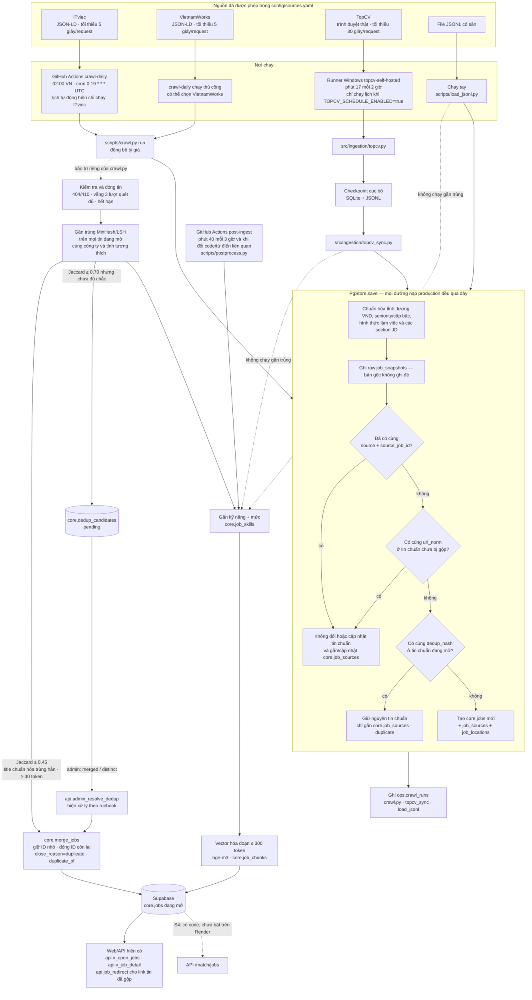

# Luồng ingestion tin tuyển dụng (Sprint 3)

S3-T10 · US-14 · Người viết: Tùng · Đối chiếu mã nguồn ngày 19/11/2026

Mọi nguồn chỉ được chạy khi đã được cho phép trong `config/sources.yaml`. Ba đường nạp production
đều chuẩn hóa và lưu bằng `PgStore.save`; khác nhau ở cách thu thập, checkpoint và các bước bảo trì
sau crawl. Cách vận hành khử trùng: [`docs/runbook/dedup.md`](../runbook/dedup.md).

## 1. Sơ đồ

> TopDev và crawler trình duyệt mới trong working tree hiện là đường local/manual, chưa có workflow
> production. Chỉ thêm chúng vào nhánh production của sơ đồ sau khi migration, lịch chạy và quy trình
> đồng bộ đã được merge và triển khai.

## 2. Điểm cần nhớ

| Điểm | Chi tiết | Ở đâu |
| --- | --- | --- |
| Lịch `crawl-daily` | Lịch 02:00 VN hiện chỉ chạy ITviec; VietnamWorks được chọn khi chạy thủ công | `.github/workflows/crawl-daily.yml` |
| Checkpoint TopCV | `topcv.py` ghi SQLite/JSONL; `topcv_sync.py` chỉ đồng bộ phần chưa đẩy lên PostgreSQL | `src/ingestion/topcv.py`, `src/ingestion/topcv_sync.py` |
| Khử trùng chính xác | Cùng mã nguồn hoặc URL có thể cập nhật tin chuẩn; chỉ nhánh trùng `dedup_hash` khác nguồn mới chỉ gắn thêm nguồn với kết quả `duplicate` | `src/ingestion/store.py` |
| Gần trùng | Tự gộp từ `0,45` khi title chuẩn hóa trùng hoàn toàn và JD đủ 30 token (S3-T05, trước là `0,85`); từ `0,70` đưa vào hàng chờ nếu chưa đủ chắc | `src/ingestion/near_dedup.py`, `src/ingestion/dedup_pg.py` |
| Gần trùng chỉ chạy trong `crawl.py` | TopCV sync và nạp JSONL chạy thẳng sang hậu xử lý; chúng được xét gần trùng ở lượt `crawl.py` sau | `src/ingestion/crawl.py` |
| `ops.crawl_runs` | Cả `crawl.py`, `topcv_sync.py` và `load_jsonl` đều ghi run khi có lượt nạp | `src/ingestion/store.py`, `src/ingestion/topcv_sync.py`, `src/ingestion/jsonl_import.py` |
| Gộp không xóa tin | Tin bị gộp được đóng, đặt `close_reason=duplicate`, `duplicate_of` trỏ tới tin giữ lại; nguồn và saved jobs được chuyển sang tin giữ | `db/migrations/0011_exact_dedup.sql` |
| Link cũ của tin đã gộp | Web gọi `api.job_redirect` rồi chuyển sang tin giữ lại (S3-H05) | `db/migrations/0015_cv_primary_redirect.sql` |
| Lưới an toàn hậu xử lý | `post-ingest` bổ sung kỹ năng/vector còn thiếu cho tin đang mở, bất kể đường nạp | `.github/workflows/post-ingest.yml` |

## 3. So với sơ đồ Sprint 2

- Có đường TopCV qua runner self-hosted và đường nạp JSONL; cả hai dùng cùng `PgStore.save`.
- Khử trùng chính xác nằm trong `PgStore.save`; gần trùng chạy sau `crawl.py` và có hàng chờ admin.
- Có vector hóa theo đoạn và workflow `post-ingest` để bắt phần hậu xử lý còn thiếu.
- Link cũ của tin đã gộp chuyển sang tin giữ lại (`api.job_redirect`, S3-H05).
- `/match/jobs` đã có code (S4-D04) nhưng chưa bật trên Render, chưa phải chức năng production.
