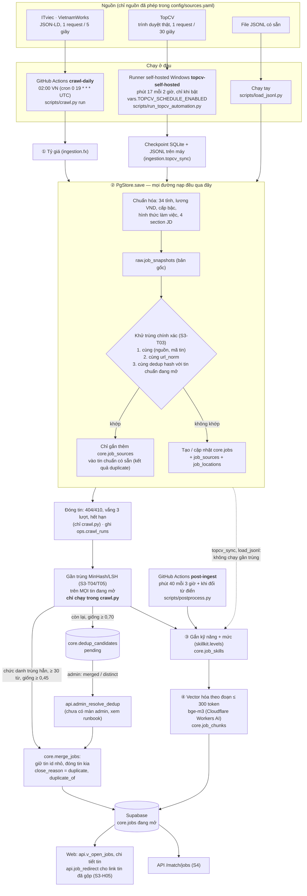

# Luồng ingestion tin tuyển dụng (cập nhật Sprint 3)

S3-T10 · US-14 · Người viết: Tùng · Cập nhật 19/11/2026 theo `main` tại #676

Sơ đồ cũ trong README chỉ có crawl → kỹ năng (Sprint 2). Từ Sprint 3 tin vào DB bằng 3 đường, có
thêm khử trùng (S3-T03/T04/T05), vector hóa (S3-D07) và workflow lưới an toàn `post-ingest`.
Cách vận hành khử trùng: [`docs/runbook/dedup.md`](../runbook/dedup.md).

## 1. Sơ đồ

## 2. Điểm cần nhớ

| Điểm | Chi tiết | Ở đâu |
| --- | --- | --- |
| Khử trùng chính xác chạy ở **mọi** đường nạp | Nằm trong `PgStore.save`, tin trùng chỉ được gắn thêm nguồn, không tạo tin chuẩn mới | `src/ingestion/store.py`, `src/ingestion/dedup.py` |
| Gần trùng chỉ chạy sau `crawl.py run` | TopCV sync và nạp JSONL **không** gọi bước này. Tin TopCV gần trùng nhau chỉ được gộp ở lượt `crawl.py` kế tiếp (bước này so mọi tin đang mở, không riêng nguồn vừa crawl) | `src/ingestion/crawl.py` (`near_dedup_after_crawl`) |
| Gộp không xóa tin | Tin bị gộp: `status = closed`, `close_reason = duplicate`, `duplicate_of` = tin giữ lại. Nguồn và tin đã lưu chuyển sang tin giữ lại | `db/migrations/0011_exact_dedup.sql` (`core.merge_jobs`) |
| Link cũ vẫn dùng được | Web gọi `api.job_redirect` rồi chuyển sang tin giữ lại | `db/migrations/0015_cv_primary_redirect.sql` |
| ③ và ④ có lưới an toàn | `post-ingest` gắn kỹ năng và vector hóa mọi tin đang mở còn thiếu, bất kể tin vào từ đường nào | `.github/workflows/post-ingest.yml` |
| Thứ tự trong `crawl.py` | gần trùng chạy **trước** ③, để không gắn kỹ năng cho tin vừa bị gộp | `src/ingestion/crawl.py` |

## 3. So với sơ đồ Sprint 2

- Thêm đường TopCV (runner self-hosted) và nạp JSONL. Cả hai ghi qua cùng `PgStore.save`.
- Thêm khử trùng chính xác trong `PgStore.save`, gần trùng sau crawl, hàng chờ admin.
- Thêm ④ vector hóa và workflow `post-ingest`.
- Tin đã gộp có link chuyển hướng (`api.job_redirect`).
